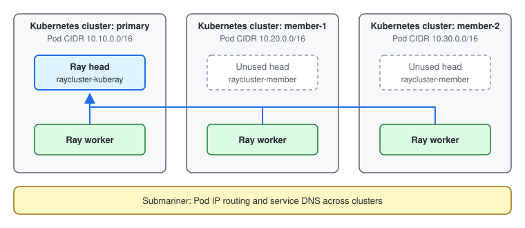

---
myst:
  html_meta:
    description: "Run one Ray cluster across multiple Kubernetes clusters with KubeRay and Submariner. Workers in member clusters join the Ray head in a primary cluster."
---

(kuberay-multi-cluster-raycluster)=

# Run a Ray cluster across multiple Kubernetes clusters

This guide shows how to run one Ray cluster whose worker nodes live in several Kubernetes clusters. It uses three local [Kind](https://kind.sigs.k8s.io/) clusters and [Submariner](https://submariner.io/) for cross-cluster networking.

:::{warning}
Workers in a member cluster exit when they can't reach the Ray head for 60 seconds, which is the default of the `gcs_rpc_server_reconnect_timeout_s` Ray system config. An outage of the link between Kubernetes clusters has the same effect on those workers as the loss of the head node.
:::

## How does it work?

One Kubernetes cluster is the *primary* cluster. It runs an ordinary RayCluster, and its head Pod is the only Ray head. Every other Kubernetes cluster is a *member* cluster. A member cluster also runs a RayCluster, but its workers don't connect to the head of that RayCluster. They start with the `address` parameter set to the head service of the primary cluster, so they join the primary Ray cluster.



KubeRay always creates a head Pod for a RayCluster, so each member cluster still has one. No worker connects to it and it runs no workload.

Ray nodes connect to each other directly by Pod IP, and member workers find the head by DNS name. This guide uses Submariner to enable both. Submariner connects the clusters with tunnels between a gateway node in each cluster and routes Pod traffic for other clusters through these tunnels. It also makes a service that you export from one cluster resolvable by DNS name in the other clusters. See the [Submariner architecture](https://submariner.io/getting-started/architecture/).

:::{note}
Ray requires that every Ray node can reach every other Ray node directly by Pod IP. To route Pod IPs between clusters, Submariner requires that the Pod and Service CIDRs of the clusters don't overlap. See the [Submariner prerequisites](https://submariner.io/getting-started/#prerequisites). Submariner's [Globalnet](https://submariner.io/getting-started/architecture/globalnet/) feature, which supports overlapping CIDRs through NAT, doesn't work with Ray, because Ray nodes advertise their own Pod IP.
:::

## Limitations

This setup has two limitations:

- Autoscaling isn't supported. Keep it disabled in every RayCluster, which is the default, and set the number of workers with `replicas`. The autoscaler of a member RayCluster connects to the unused head, which has no view of the workload.
- `kubectl get rayclusters` reports only the Pods of its own Kubernetes cluster. Use `ray status` on the primary head to see the whole Ray cluster.

## Prerequisites

Install the following tools:

- [Docker](https://docs.docker.com/engine/install/)
- [Kind](https://kind.sigs.k8s.io/docs/user/quick-start/#installation)
- [kubectl](https://kubernetes.io/docs/tasks/tools/#kubectl)
- [Helm](https://helm.sh/docs/intro/install/)

The Ray Pods in this guide request 5 CPUs and 10 GiB of memory in total. Give Docker enough resources for them and for the Kubernetes and Submariner components of three clusters.

## Step 1: Create three Kind clusters

This step creates three local Kubernetes clusters with Kind. If you already have Kubernetes clusters whose Pod and Service CIDRs don't overlap, skip this step.

Create the `primary`, `member-1`, and `member-2` clusters. Each cluster gets its own Pod and Service CIDR.

```bash
cat <<EOF | kind create cluster --name primary --config -
kind: Cluster
apiVersion: kind.x-k8s.io/v1alpha4
networking:
  podSubnet: 10.10.0.0/16
  serviceSubnet: 10.110.0.0/16
EOF

cat <<EOF | kind create cluster --name member-1 --config -
kind: Cluster
apiVersion: kind.x-k8s.io/v1alpha4
networking:
  podSubnet: 10.20.0.0/16
  serviceSubnet: 10.120.0.0/16
EOF

cat <<EOF | kind create cluster --name member-2 --config -
kind: Cluster
apiVersion: kind.x-k8s.io/v1alpha4
networking:
  podSubnet: 10.30.0.0/16
  serviceSubnet: 10.130.0.0/16
EOF
```

Kind adds the `kind-primary`, `kind-member-1`, and `kind-member-2` contexts to your kubeconfig. The commands in this guide select a cluster with the `--context` flag. Check that the node of each cluster is ready:

```bash
for ctx in kind-primary kind-member-1 kind-member-2; do
  kubectl --context $ctx get nodes
done
```

```text
NAME                    STATUS   ROLES           AGE   VERSION
primary-control-plane   Ready    control-plane   42s   v1.36.1
NAME                     STATUS   ROLES           AGE   VERSION
member-1-control-plane   Ready    control-plane   29s   v1.36.1
NAME                     STATUS   ROLES           AGE   VERSION
member-2-control-plane   Ready    control-plane   20s   v1.36.1
```

## Step 2: Connect the clusters with Submariner

Submariner uses one cluster as the *broker*. The broker is a set of custom resources on that cluster's Kubernetes API server, through which the clusters exchange connection details. See the [Submariner broker architecture](https://submariner.io/getting-started/architecture/broker/). This guide uses the primary cluster as the broker.

Set up the `subctl` command-line tool:

:::::{tab-set}

::::{tab-item} Kind
:sync: kind

By default, Kind writes `127.0.0.1` as the Kubernetes API server address in your kubeconfig, which only your machine can reach. Submariner in the member clusters needs an address for the broker that works between the Kind nodes. Export a kubeconfig for each cluster that uses the address inside the `kind` Docker network:

```bash
for cluster in primary member-1 member-2; do
  kind get kubeconfig --internal --name $cluster > kubeconfig-$cluster
done
```

Those addresses resolve only inside the `kind` Docker network, so run `subctl` from a container in that network. Define a shell function that does so:

```bash
subctl() {
  docker run --rm --network kind --user "$(id -u):$(id -g)" -v "$PWD":/work -w /work \
    -e KUBECONFIG=/work/kubeconfig-primary:/work/kubeconfig-member-1:/work/kubeconfig-member-2 \
    quay.io/submariner/subctl:0.25.0 subctl "$@"
}
```

The function runs the [`subctl` image](https://quay.io/repository/submariner/subctl) that Submariner publishes. Kind attaches the nodes of all its clusters to one Docker network named `kind`, and the `--network kind` option attaches the `subctl` container to the same network.

Check that the function works. The first run takes longer because Docker pulls the image.

```bash
subctl version
```

```text
subctl version: release-0.25-e8abf89e5fd9
```

Run the rest of this guide in the same shell and directory.

:::{note}
Running `subctl` in a container also avoids a certificate error on macOS. With `subctl` v0.25.0 installed on a macOS host, `subctl join` fails to verify the certificate of the Kind API server. Submariner also provides scripts that create Kind clusters and deploy Submariner in one step. See the [Submariner Kind quickstart](https://submariner.io/getting-started/quickstart/kind/).
:::

::::

::::{tab-item} Other Kubernetes clusters
:sync: other

Install `subctl` on your machine by following the [Submariner subctl installation guide](https://submariner.io/operations/deployment/subctl/):

```bash
curl -Ls https://get.submariner.io | bash
export PATH=$PATH:~/.local/bin
```

In the rest of this guide, replace `kind-primary`, `kind-member-1`, and `kind-member-2` with the kubeconfig contexts of your clusters. Check the [Submariner prerequisites](https://submariner.io/getting-started/#prerequisites) for the network requirements of your environment.

::::

:::::

Deploy the broker on the primary cluster. This command writes the connection details for the broker to the `broker-info.subm` file in the current directory.

```bash
subctl deploy-broker --context kind-primary
```

```text
 • Setting up broker RBAC  ...
 ✓ Setting up broker RBAC
 • Deploying the Submariner operator  ...
 ✓ Deploying the Submariner operator
 ...
 • Deploying the broker  ...
 ✓ Deploying the broker
 • Saving broker info to file "broker-info.subm"  ...
 ✓ Saving broker info to file "broker-info.subm"
```

Join all three clusters to the broker:

```bash
subctl join broker-info.subm --context kind-primary --clusterid primary
subctl join broker-info.subm --context kind-member-1 --clusterid member-1
subctl join broker-info.subm --context kind-member-2 --clusterid member-2
```

Each command prints output similar to the following. The `Cluster CIDRs` line shows the `podSubnet` and the `Service CIDRs` line shows the `serviceSubnet` that you set for the cluster in Step 1.

```text
 ✓ broker-info.subm indicates broker is at https://primary-control-plane:6443
 • Discovering network details  ...
        Network plugin:  kindnet
        Service CIDRs:   [10.110.0.0/16]
        Cluster CIDRs:   [10.10.0.0/16]
 ✓ Discovering network details
 ...
 • Labeling node "primary-control-plane" as a gateway  ...
 ✓ Labeling node "primary-control-plane" as a gateway
 ...
 • Connecting to Broker  ...
 ✓ Connecting to Broker
 • Deploying submariner  ...
 ✓ Deploying submariner
 ✓ Submariner is up and running
```

Check the connections from the primary cluster:

```bash
subctl show connections --context kind-primary
```

```text
 • Showing Connections  ...
 ✓ Showing Connections
GATEWAY                  CLUSTER    REMOTE IP      NAT   CABLE DRIVER   SUBNETS                       STATUS      RTT avg.
member-1-control-plane   member-1   192.168.97.5   no    libreswan      10.120.0.0/16, 10.20.0.0/16   connected   172.927µs
member-2-control-plane   member-2   192.168.97.6   no    libreswan      10.130.0.0/16, 10.30.0.0/16   connected   165.717µs
```

The primary cluster has one connection to each member cluster, and the `STATUS` of both is `connected`. The `SUBNETS` column lists the Service and Pod CIDRs that Submariner routes to that cluster. A connection can take a minute to appear. Run the command again if a member cluster is missing.

## Step 3: Install the KubeRay operator

Install the KubeRay operator in all three clusters by following {ref}`kuberay-operator-deploy`. Each cluster needs its own operator to manage the RayCluster in that cluster. With Helm, run the installation once per cluster with the following commands:

```bash
helm repo add kuberay https://ray-project.github.io/kuberay-helm/
helm repo update

for ctx in kind-primary kind-member-1 kind-member-2; do
  kubectl --context $ctx create namespace ray-system
  helm install kuberay-operator kuberay/kuberay-operator --version 1.7.0 -n ray-system --kube-context $ctx
done
```

Check that the operator Pod is running in each cluster:

```bash
for ctx in kind-primary kind-member-1 kind-member-2; do
  kubectl --context $ctx get pods -n ray-system
done
```

```text
NAME                                READY   STATUS    RESTARTS   AGE
kuberay-operator-75f455bdff-tnj74   1/1     Running   0          15s
NAME                                READY   STATUS    RESTARTS   AGE
kuberay-operator-75f455bdff-lxj4s   1/1     Running   0          14s
NAME                                READY   STATUS    RESTARTS   AGE
kuberay-operator-75f455bdff-vq4b8   1/1     Running   0          12s
```

## Step 4: Create the RayCluster in the primary cluster

The RayCluster in the primary cluster needs no special configuration. Create one from the basic sample:

```bash
kubectl --context kind-primary apply -f https://raw.githubusercontent.com/kuberay-project/kuberay/master/ray-operator/config/samples/ray-cluster.sample.yaml
```

Wait until the RayCluster is ready:

```bash
kubectl --context kind-primary get rayclusters
```

```text
NAME                 DESIRED WORKERS   AVAILABLE WORKERS   CPUS   MEMORY   GPUS   STATUS   AGE
raycluster-kuberay   1                 1                   2      6Gi      0      ready    44s
```

List the Pods with their IP addresses:

```bash
kubectl --context kind-primary get pods --selector=ray.io/cluster=raycluster-kuberay -o wide
```

```text
NAME                                          READY   STATUS    RESTARTS   AGE   IP           NODE                    NOMINATED NODE   READINESS GATES
raycluster-kuberay-head-vh4b8                 1/1     Running   0          44s   10.10.0.11   primary-control-plane   <none>           <none>
raycluster-kuberay-workergroup-worker-jv76l   1/1     Running   0          44s   10.10.0.12   primary-control-plane   <none>           <none>
```

Both Pods have an IP address in `10.10.0.0/16`, the Pod CIDR of the primary cluster.

Export the head service so that the member clusters can resolve it:

```bash
subctl export service --context kind-primary --namespace default raycluster-kuberay-head-svc
```

```text
 ✓ Service exported successfully
```

A Kubernetes service name that ends in `cluster.local` resolves only inside its own cluster. Submariner makes an exported service resolvable from every connected cluster under the `clusterset.local` domain. See [Submariner service discovery](https://submariner.io/getting-started/architecture/service-discovery/). Pods in the member clusters can now reach the head service as `raycluster-kuberay-head-svc.default.svc.clusterset.local`.

## Step 5: Create the RayClusters in the member clusters

Create the same RayCluster in both member clusters:

```bash
for ctx in kind-member-1 kind-member-2; do
  kubectl --context $ctx apply -f https://raw.githubusercontent.com/kuberay-project/kuberay/master/ray-operator/config/samples/ray-cluster.multi-cluster-member.yaml
done
```

The following excerpt shows the settings that make it a member RayCluster:

```yaml
spec:
  headGroupSpec:
    rayStartParams:
      # No worker connects to this head.
      num-cpus: "0"
  workerGroupSpecs:
  - groupName: member-group
    rayStartParams:
      # Address of the Ray head in the primary cluster.
      address: raycluster-kuberay-head-svc.default.svc.clusterset.local:6379
```

The `address` parameter points the workers at the exported head service of the primary cluster. The `rayVersion` and the Ray image must match the RayCluster in the primary cluster. Use a `groupName` that differs from the worker groups in the primary cluster. The output of `ray status` and `ray list nodes` then shows which nodes are in a member cluster. To also tell the member clusters apart, give each member RayCluster its own `groupName`.

List the Pods in each member cluster:

```bash
for ctx in kind-member-1 kind-member-2; do
  kubectl --context $ctx get pods --selector=ray.io/cluster=raycluster-member -o wide
done
```

```text
NAME                                          READY   STATUS    RESTARTS   AGE   IP           NODE                     NOMINATED NODE   READINESS GATES
raycluster-member-head-l4nl2                  1/1     Running   0          62s   10.20.0.11   member-1-control-plane   <none>           <none>
raycluster-member-member-group-worker-nwfkm   1/1     Running   0          62s   10.20.0.12   member-1-control-plane   <none>           <none>
NAME                                          READY   STATUS    RESTARTS   AGE   IP           NODE                     NOMINATED NODE   READINESS GATES
raycluster-member-head-zjdhp                  1/1     Running   0          62s   10.30.0.11   member-2-control-plane   <none>           <none>
raycluster-member-member-group-worker-rczcd   1/1     Running   0          62s   10.30.0.12   member-2-control-plane   <none>           <none>
```

Each member cluster runs one worker Pod and the unused head Pod. The worker IP addresses are `10.20.0.12` and `10.30.0.12`, one in the Pod CIDR of each member cluster.

## Step 6: Verify the Ray cluster

Check the status of the Ray cluster from the head Pod in the primary cluster:

```bash
export HEAD_POD=$(kubectl --context kind-primary get pods --selector=ray.io/node-type=head -o custom-columns=POD:metadata.name --no-headers)
kubectl --context kind-primary exec -it $HEAD_POD -- ray status
```

```text
======== Autoscaler status: 2026-11-12 03:23:51.506053 ========
Node status
---------------------------------------------------------------
Active:
 (no active nodes)
Idle:
 2 member-group
 1 workergroup
 1 headgroup
Pending:
 (no pending nodes)
Recent failures:
 (no failures)

Resources
---------------------------------------------------------------
Total Usage:
 0.0/4.0 CPU
 0B/8.00GiB memory
 0B/2.03GiB object_store_memory

From request_resources:
 (none)
Pending Demands:
 (no resource demands)
```

The Ray cluster has four nodes. The `headgroup` and `workergroup` nodes are the two Pods in the primary cluster. The two `member-group` nodes are the workers in `member-1` and `member-2`.

To see the IP address and the `ray.io/node-group` label of each node, run `ray list nodes` in the head Pod:

```bash
kubectl --context kind-primary exec -it $HEAD_POD -- ray list nodes
```

## Step 7: Run tasks across the clusters

Run a Ray script on the primary head. For every pair of nodes, the script creates 5 MiB of data in a task on one node and reads it in a task on the other node. Ray transfers data of this size directly between the two nodes.

```bash
kubectl --context kind-primary exec -i $HEAD_POD -- python - <<EOF
from itertools import combinations

import numpy as np
import ray
from ray.util.scheduling_strategies import NodeAffinitySchedulingStrategy

ray.init()


@ray.remote
def create_data():
    # 5 MiB, large enough for Ray to transfer it directly between nodes.
    return np.zeros(5 * 1024 * 1024, dtype=np.uint8)


@ray.remote
def read_data(data):
    return data.nbytes


def pin_to_node(task, node):
    return task.options(scheduling_strategy=NodeAffinitySchedulingStrategy(node["NodeID"], soft=False))


# Create data on one node and read it on another, for every pair of nodes.
nodes = [node for node in ray.nodes() if node["Alive"]]
for creator, reader in combinations(nodes, 2):
    data = pin_to_node(create_data, creator).remote()
    ray.get(pin_to_node(read_data, reader).remote(data))
    print(
        f"{creator['Labels']['ray.io/node-group']} ({creator['NodeManagerAddress']}) -> "
        f"{reader['Labels']['ray.io/node-group']} ({reader['NodeManagerAddress']})"
    )
EOF
```

```text
...
member-group (10.20.0.12) -> member-group (10.30.0.12)
member-group (10.20.0.12) -> headgroup (10.10.0.11)
member-group (10.20.0.12) -> workergroup (10.10.0.12)
member-group (10.30.0.12) -> headgroup (10.10.0.11)
member-group (10.30.0.12) -> workergroup (10.10.0.12)
headgroup (10.10.0.11) -> workergroup (10.10.0.12)
```

Each line is one pair of nodes. A task on the first node created the data, and a task on the second node read it. The output shows that nodes in different clusters reach each other directly.

## Step 8: Clean up

::::{tab-set}

:::{tab-item} Kind
:sync: kind

Delete the Kind clusters and the files that this guide created. Deleting a cluster also removes everything installed in it.

```bash
kind delete clusters primary member-1 member-2
rm -f broker-info.subm kubeconfig-primary kubeconfig-member-1 kubeconfig-member-2
```

:::

:::{tab-item} Other Kubernetes clusters
:sync: other

Remove the service export and the RayClusters, then uninstall the KubeRay operator and Submariner from each cluster. Uninstall from the member clusters first. `subctl uninstall` removes the broker from the primary cluster only when no other cluster uses it. See [Uninstalling Submariner](https://submariner.io/operations/cleanup/).

```bash
# Stop exporting the head service, then delete the RayClusters.
subctl unexport service --context <primary-context> --namespace default raycluster-kuberay-head-svc
kubectl --context <member-1-context> delete raycluster raycluster-member
kubectl --context <member-2-context> delete raycluster raycluster-member
kubectl --context <primary-context> delete raycluster raycluster-kuberay

# Uninstall the KubeRay operator and delete its namespace.
helm uninstall kuberay-operator -n ray-system --kube-context <member-1-context>
helm uninstall kuberay-operator -n ray-system --kube-context <member-2-context>
helm uninstall kuberay-operator -n ray-system --kube-context <primary-context>
kubectl --context <member-1-context> delete namespace ray-system
kubectl --context <member-2-context> delete namespace ray-system
kubectl --context <primary-context> delete namespace ray-system

# Uninstall Submariner. Uninstall from the primary cluster last.
subctl uninstall --context <member-1-context> --yes
subctl uninstall --context <member-2-context> --yes
subctl uninstall --context <primary-context> --yes

rm -f broker-info.subm
```

:::

::::
