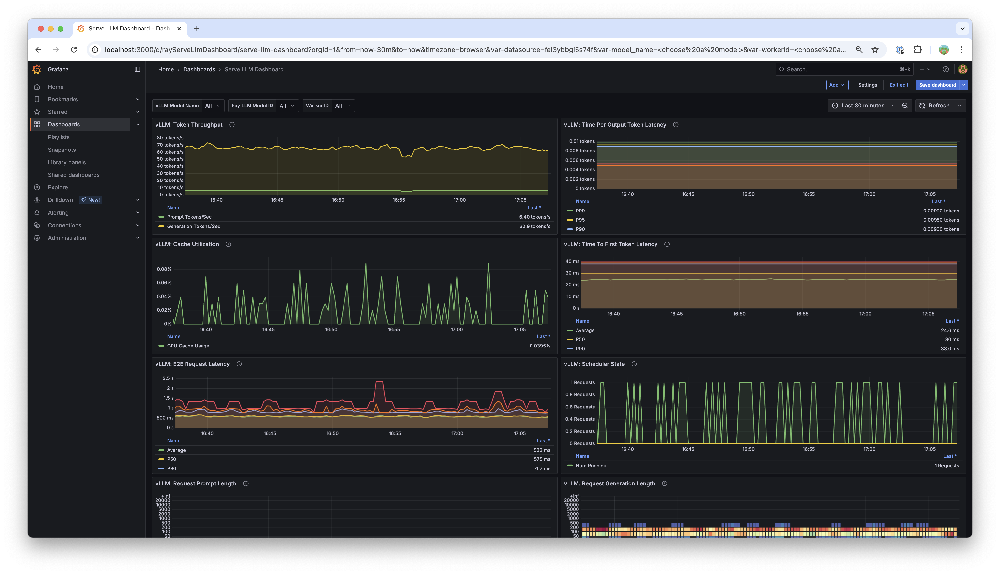

---
myst:
  html_meta:
    description: "Monitor Ray Serve LLM deployments with service-level and engine metrics, a Grafana dashboard, and usage data collection."
---

(observability-guide)=
# Observability and monitoring

Monitor your LLM deployments with built-in metrics, dashboards, and logging.

Ray Serve LLM includes the following observability features:

- **Service-level metrics**: Request and token behavior across deployed models.
- **Engine metrics**: vLLM-specific performance metrics such as TTFT and TPOT.
- **Grafana dashboards**: Pre-built dashboard for LLM-specific visualizations.
- **Prometheus integration**:  Export capability for all metrics for custom monitoring and alerting.

## Service-level metrics

Ray enables LLM service-level logging by default, making these statistics available through Grafana and Prometheus. For more details on configuring Grafana and Prometheus, see {ref}`collect-metrics`.

These higher-level metrics track request and token behavior across deployed models:

- Average total tokens per request
- Ratio of input tokens to generated tokens
- Peak tokens per second
- Request latency and throughput
- Model-specific request counts

## Grafana dashboard

Ray includes a Serve LLM-specific dashboard, which is automatically available in Grafana:



The dashboard includes visualizations for:

- **Request metrics**: Throughput, latency, and error rates.
- **Token metrics**: Input/output token counts and ratios.
- **Performance metrics**: Time to first token (TTFT), time per output token (TPOT).
- **Resource metrics**: GPU cache utilization, memory usage.

## Engine metrics

All engine metrics, including vLLM, are available through the Ray metrics export endpoint and are queryable with Prometheus. See [vLLM metrics](https://docs.vllm.ai/en/stable/usage/metrics/) for a complete list. The Serve LLM Grafana dashboard also visualizes these metrics.

Key engine metrics include:

- **Time to first token (TTFT)**: Latency before the first token is generated.
- **Time per output token (TPOT)**: Average latency per generated token.
- **GPU cache utilization**: KV cache memory usage.
- **Batch size**: Current and average batch sizes.
- **Throughput**: Requests per second and tokens per second.

### Configure engine metrics

Engine metric logging is on by default as of Ray 2.51. To disable engine-level metric logging, set `log_engine_metrics: False` when configuring the LLM deployment:

::::{tab-set}

:::{tab-item} Python
:sync: builder

```python
from ray import serve
from ray.serve.llm import LLMConfig, build_openai_app

llm_config = LLMConfig(
    model_loading_config=dict(
        model_id="qwen-0.5b",
        model_source="Qwen/Qwen2.5-0.5B-Instruct",
    ),
    deployment_config=dict(
        autoscaling_config=dict(
            min_replicas=1, max_replicas=2,
        )
    ),
    log_engine_metrics=False  # Disable engine metrics
)

app = build_openai_app({"llm_configs": [llm_config]})
serve.run(app, blocking=True)
```
:::

:::{tab-item} YAML
:sync: bind

```yaml
# config.yaml
applications:
- args:
    llm_configs:
        - model_loading_config:
            model_id: qwen-0.5b
            model_source: Qwen/Qwen2.5-0.5B-Instruct
        accelerator_type: A10G
        deployment_config:
            autoscaling_config:
                min_replicas: 1
                max_replicas: 2
        log_engine_metrics: false  # Disable engine metrics
  import_path: ray.serve.llm:build_openai_app
  name: llm_app
  route_prefix: "/"
```
:::

::::

## Experimental GenAI workflow tracing

The typed OpenAI request pipeline can emit workflow spans for the ingress,
prefill/decode orchestration, and each inference replica. To enable this feature,
install the optional exporter on every replica:

```shell
pip install opentelemetry-exporter-otlp-proto-grpc
```

Set these environment variables in the ingress and worker runtime environments:

```shell
OTEL_SEMCONV_STABILITY_OPT_IN=gen_ai_latest_experimental
OTEL_EXPORTER_OTLP_TRACES_ENDPOINT=http://collector:4317
OTEL_EXPORTER_OTLP_TRACES_INSECURE=true
OTEL_SERVICE_NAME=ray-llm
```

Use an endpoint and TLS settings appropriate for your collector. Set
`OTEL_RESOURCE_ATTRIBUTES` on each replica to identify its actual process or pod,
for example `k8s.pod.uid`, `k8s.pod.name`, and `k8s.namespace.name`. In Kubernetes,
populate these values with the Downward API. These attributes identify the
replica that emits the span, including separate prefill and decode pods.

The ingress extracts W3C `traceparent` and `tracestate` headers. A private request
field carries the context through Ray deployment calls and request copies without
adding it to the public OpenAI JSON schema. Streaming spans remain open until
completion, cancellation, or failure. Context is detached between stream yields
to keep concurrent requests separate. Sampling follows the parent decision;
configure root sampling with `OTEL_TRACES_SAMPLER` and `OTEL_TRACES_SAMPLER_ARG`.

Spans use `gen_ai.operation.name=invoke_workflow`. They do not record prompts,
responses, or token counts. A separate OpenTelemetry provider exports these
workflow spans, without adding an exporter to the provider used by other Ray
instrumentation. The GenAI conventions are experimental and can change.

This opt-in currently covers `/v1/chat/completions` and `/v1/completions` through
`OpenAiIngress`, including the typed prefill/decode orchestration path. It does
not instrument the engine-native ASGI direct-streaming path
(`RAY_SERVE_LLM_ENABLE_DIRECT_STREAMING=1`) or other endpoints. Without the
opt-in, no new spans or exporters are created. Restart replicas after changing
exporter settings.

## Usage data collection

The Ray Team collects usage data to improve Ray Serve LLM. The team collects data about the following features and attributes:

- Model architecture used for serving.
- Whether JSON mode is used.
- Whether LoRA is used and how many LoRA weights are loaded initially at deployment time.
- Whether autoscaling is used and the min and max replicas setup.
- Tensor parallel size used.
- Initial replicas count.
- GPU type used and number of GPUs used.

To opt out from usage data collection, see {ref}`Ray usage stats <ref-usage-stats>` for how to disable it.

## See also

- {ref}`collect-metrics` - Ray metrics collection guide
- [vLLM metrics documentation](https://docs.vllm.ai/en/stable/usage/metrics/)
- {doc}`Troubleshooting <../troubleshooting>` - Common issues and solutions

