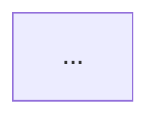

# Agent Instructions for Ray Data

> These instructions apply to all AI-assisted contributions under `python/ray/data/`.
> They are in addition to the repository-wide policy in the root
> [`AGENTS.md`](../../../AGENTS.md), which always applies.

## PR Description Requirements

Every Ray Data PR description must follow these rules:

### 1. Be succinct

- Lead with one or two sentences stating what the PR changes and why.
- No filler, no restating the diff file-by-file, no boilerplate sections that
  don't apply. If a section would be empty, omit it.

### 2. Include a mermaid diagram of the new data flow

If the PR changes how data moves — through operators, planners, datasources,
block transforms, the streaming executor, or between processes — include a
mermaid diagram showing the **new** data flow:


Keep the diagram scoped to the components the PR actually touches. A diagram
of the entire execution pipeline is not useful; a diagram of the changed path
is.

### 3. Clearly state the before and after state

Describe both states explicitly so reviewers don't have to reverse-engineer
the baseline from the diff:

- **Before:** what the system did prior to this PR (behavior, data flow,
  performance characteristic, or bug).
- **After:** what it does with this PR applied, and what users or operators
  will observe differently.

If behavior is unchanged (pure refactor), say so explicitly and state what
invariant was preserved and how it was verified.

### Template

````markdown
## Summary
<one or two sentences: what changed and why>

## Before
<prior behavior / data flow / bug>

## After
<new behavior and what's observably different>

## Data flow


## Testing
<commands run and results>
````
