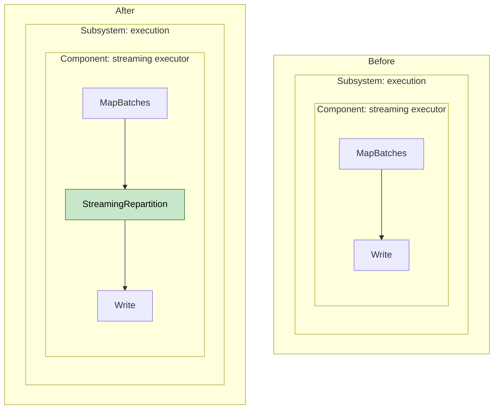

# Agent Instructions for Ray Data

> These instructions apply to all AI-assisted contributions under `python/ray/data/`.
> They are in addition to the repository-wide policy in the root
> [`AGENTS.md`](../../../AGENTS.md), which always applies.

## PR Description Requirements

Every Ray Data PR description must follow these rules:

### 1. Be succinct

- Lead with one or two sentences stating what the PR changes and why.
- No filler, no restating the diff file-by-file, no boilerplate sections that
  don't apply. If a section would be empty, omit it.

### 2. Include a mermaid diagram of the new data flow

If the PR changes how data moves — through operators, planners, datasources,
block transforms, the streaming executor, or between processes — include a
mermaid diagram showing the **new** data flow:


Keep the diagram scoped to the components the PR actually touches. A diagram
of the entire execution pipeline is not useful; a diagram of the changed path
is.

### 3. Clearly state the before and after state

Describe both states explicitly so reviewers don't have to reverse-engineer
the baseline from the diff:

- **Before:** what the system did prior to this PR (behavior, data flow,
  performance characteristic, or bug).
- **After:** what it does with this PR applied, and what users or operators
  will observe differently.

When possible, express before vs. after as a single mermaid diagram with
color coding so the difference is interpretable at a glance: put the two
states in `Before` and `After` subgraphs, and color components that are
removed, added, or changed — leave unchanged components uncolored.

Structure each side **from high level to low level**: start at the subsystem
(use the vocabulary from section 4), then the component within it, down to
the specific piece that changed. The diagram should show a reviewer not just
*what* changed but *which subsystem it lives in and where inside that
subsystem* — demonstrating the author has that context is the point.



Pick the drill-down depth that locates the change precisely: subsystem →
module → operator/class → method, stopping at the level where the change
actually lives. Collapse levels that add no information.

If behavior is unchanged (pure refactor), say so explicitly and state what
invariant was preserved and how it was verified.

### 4. List the Ray Data subsystems touched

Name the subsystems the PR changes so reviewers and CODEOWNERS can route and
scope their review. Use these names (with the main code location):

- **API** — public `Dataset`/`DataIterator`/`read_*` surface (`dataset.py`, `read_api.py`, `iterator/`)
- **Logical planning / query optimization** — logical operators, optimizer rules (`_internal/logical/`)
- **Physical planning** — logical-to-physical translation (`_internal/planner/`)
- **Execution** — streaming executor, physical operators (`_internal/execution/`)
- **Resource allocation / backpressure** — resource manager, backpressure policies, autoscaling (`_internal/execution/resource_manager.py`, `backpressure_policy/`, `autoscaler/`, `actor_autoscaler/`, `cluster_autoscaler/`)
- **IO** — datasources and datasinks (`_internal/datasource/`, `_internal/datasource_v2/`, `datasource/`)
- **Block / data format** — block builders, Arrow/pandas blocks, batching (`arrow_block.py`, `pandas_block.py`, `block_batching/`, `batcher.py`)
- **Shuffle / aggregation** — sorts, joins, repartitions, aggregates (`aggregate.py`, `gpu_shuffle/`, shuffle operators)
- **Observability** — stats, metrics, progress, issue detection (`stats.py`, `progress/`, `issue_detection/`, exporters)

A single line is enough, e.g. `Subsystems: physical planning, execution`. If a
change spans many subsystems, call out which one carries the behavioral change
versus which are mechanical ripple edits.

### Template

````markdown
## Summary
<one or two sentences: what changed and why>

## Before
<prior behavior / data flow / bug>

## After
<new behavior and what's observably different>

<!-- Where possible, show before vs. after as one color-coded mermaid diagram
     (Before/After subgraphs; red = removed, green = added, yellow = changed),
     structured high level to low level: subsystem -> component -> change -->

## Subsystems
<e.g. logical planning, execution, resource allocation>

## Data flow
<!-- Optional - include only if data flow changes -->


## Testing
<commands run and results>
````
